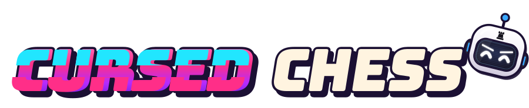
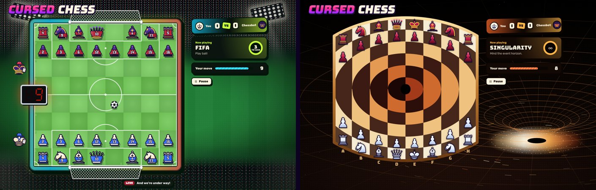

<h1 align="center">
  
</h1>

You've never played chess like this before!

Play it [here](https://joshuaswanson.github.io/cursed-chess/).



## What it is

It starts as a plain chess site. A couple of moves in, the computer opponent gets
bored, takes the site over, and rewrites the rules every 45 seconds.

- **Story Mode** plays through 15 modes against Chessbot and ends in a final
  battle.
- **Single modes** let you pick one: Portals, Fog of War, FIFA, Tug of War,
  Minefield, Battle Royale, Clash Royale, King of the Hill, Thunderstorm,
  Gravity, Hex Chess, Zombies, Stratego, Factory Floor, Lanterns.
- **Beta modes** are still being worked on: Singularity, Immortal Snail,
  Trenches, Pac-Man, Heist.
- **Multiplayer** lets you play a friend online with a five-letter code.

The game is in English, French and German.

## Running it

```sh
npm install
npm run dev
```

| Command              | What it does                                                 |
| -------------------- | ------------------------------------------------------------ |
| `npm run dev`        | Runs the game locally with live reload                       |
| `npm run build`      | Builds the site into `dist`                                  |
| `npm test`           | Runs the rule tests, and random games through every mode     |
| `npm run check:i18n` | Lists English text with no French or German wording          |
| `npm run check`      | Type check, lint, formatting, translations and tests at once |

Every push to `main` runs `npm run check` and, if it passes, deploys to GitHub
Pages.

## How it is built

React, TypeScript, Vite and Zustand, with no game engine and no image or sound
assets beyond the piece artwork, a few textures and the soundtrack. Sound
effects are synthesized in the browser.

- `src/engine` is plain chess: the board, move generation, check and mate.
- `src/plugins` holds one file per mode. A mode is a plugin that changes the
  legal moves, reacts to moves and turns, and says what to draw.
- `src/modes.ts` lists the modes in order.
- `src/stores/gameStore.ts` runs the game: turns, clocks, Chessbot and the story.
- `src/components` draws it, with each mode's board layers loaded on demand.
- `src/i18n` holds the French and German wording, keyed by the English.

Music by maksymmalko.
